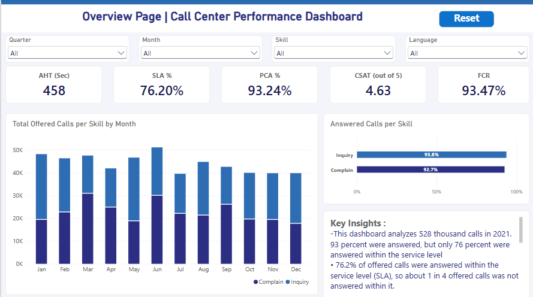
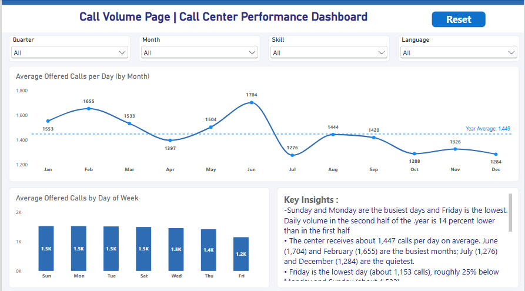
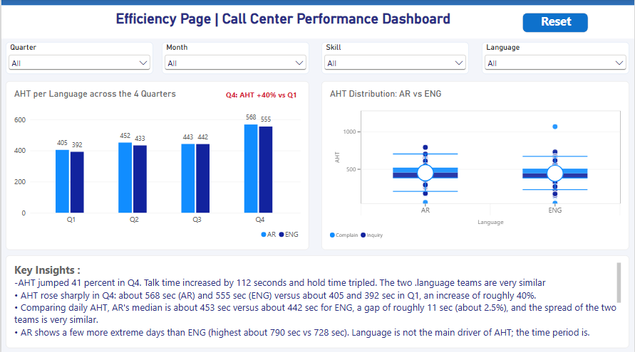
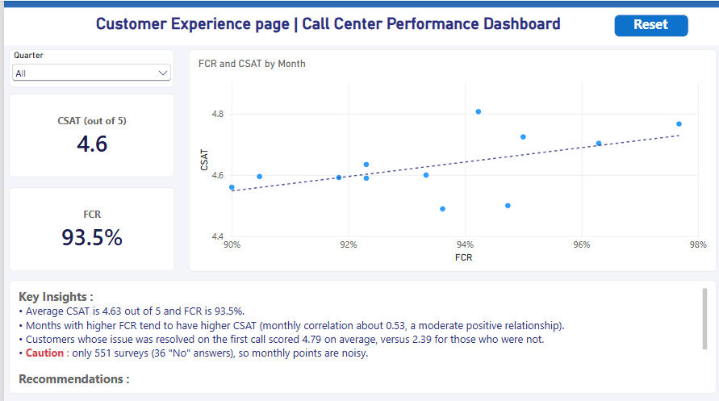
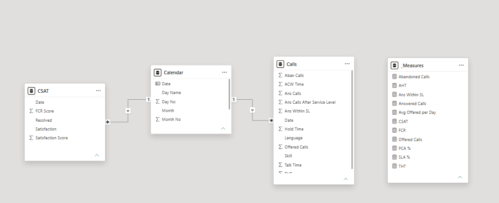

# Call Center Performance Analysis | Power BI

> Service improved in Q4, but every call became **41% longer**. This dashboard shows where the call center loses customers and time, and what to do first.

A four-page Power BI dashboard built on **528,107 calls** and **551 customer surveys** from 2021. It answers three business questions:

1. How fast and how reliably does the center answer calls?
2. Why did handle time change, and is language a factor?
3. What drives customer satisfaction?

## Headline results

| Metric | Value |
|---|---|
| Offered calls / answered | 528,107 / 492,391 (PCA 93.2%) |
| Abandoned before an agent answered | 35,716 (6.8%) |
| Answered within the service level (SLA) | 76.2% |
| Average handle time (AHT) | 458 seconds |
| AHT Q1 to Q4 | 398 to 561 seconds (+41%) |
| CSAT / FCR | 4.63 out of 5 / 93.5% |
| CSAT resolved vs unresolved on first call | 4.79 vs 2.39 |

## What the data showed

- **About 1 in 4 calls was not answered within the service level.** 35,716 customers hung up before an agent answered.
- **The year was not stable.** Q2 and Q3 were the weakest (SLA about 69% and 70%). Q4 was the best (SLA 83.1%), but calls were 41% longer: talk time +112 seconds and hold time tripled, about 5,191 extra agent hours.
- **Language is not the problem.** The AR and ENG teams have almost the same AHT distribution (median gap about 11 seconds). Time matters about 25 times more.
- **Outliers need context.** 11 of 14 outlier days had 1 to 6 calls (noise); 3 days in November were real and call for investigation.
- **First call resolution is what customers feel.** Resolved customers scored 4.79; unresolved scored 2.39.

## What I'd recommend

1. **Investigate Q4 hold time and the November event** (system logs, call reasons, transfers, new agents).
2. **Match staffing to demand and cut abandonment in peaks:** more agents on Sunday and Monday, fewer on Friday, a plan for June, and callbacks.
3. **Run a first call resolution program** and call back unresolved customers.
4. **Fix measurement:** agree targets with the business, raise survey coverage, record skill and language in the survey.

Full detail: [`docs/Insights_and_Recommendations.md`](docs/Insights_and_Recommendations.md) ([PDF](docs/Insights_and_Recommendations.pdf)).

## Dashboard

### Overview


### Call Volume


### Efficiency


### Customer Experience


Interactive features: slicers (quarter, month, skill, language), drill-through to a skill detail page, tooltips with AHT/SLA/PCA, and a reset bookmark.

## KPI definitions

| KPI | Definition |
|---|---|
| AHT | (Talk time + hold time + after-call work) / answered calls |
| SLA % | Calls answered within the service level / offered calls |
| PCA % | Answered calls / offered calls |
| CSAT | Average satisfaction score (1 to 5) |
| FCR | Share of issues resolved on the first call |

## Data model

A calendar table connects the call data and the survey data by date (one-to-many, single direction).



## Assumptions and limitations

- No targets were provided with the data, so periods are compared with each other.
- The service level threshold (in seconds) is not given in the data.
- No staffing or call reason data, so explanations for Q4 and Q2 to Q3 are hypotheses to validate.
- The survey covers 0.11% of answered calls and has no skill or language; correlation between FCR and CSAT is not proof of causation.

## Repository structure

```
call-center-performance-powerbi/
├── README.md
├── powerbi/        # Power BI dashboard (.pbix)
├── docs/           # Insights and recommendations (md + pdf)
├── images/         # Dashboard pages and data model
└── data/           # Data structure notes (original files not included)
```

## Data

The original source files are not included. The Power BI file contains the imported tables used by the dashboard. See [`data/README.md`](data/README.md) for the structure.

## Author

**Ahmed Elsayed**, Data Analyst and BI Developer
[LinkedIn](https://www.linkedin.com/in/ahmed-elsayed77) | [Portfolio](https://ahmedelsayedportfolio.pages.dev) | [GitHub](https://github.com/AhmedElsayed77)
